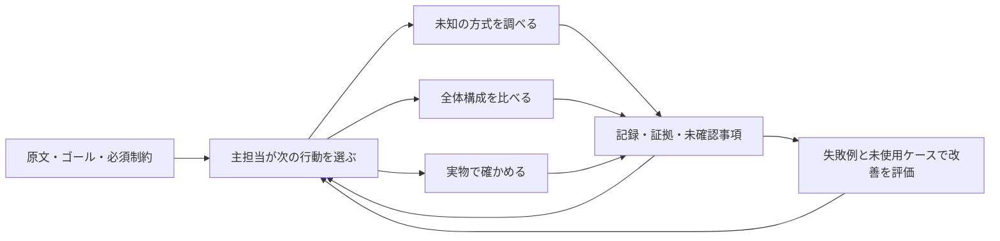

# Outcome Harness

現在は仮称です。製品名の選定後に、技能名と呼び出し名も揃えます。

**ゴールを見失わず、知らない方法を探し、実物の証拠で判断を育てる。**

Codex と Claude Code で使う、開発のための AI ハーネスです。入口から必要な技能だけを読み、探索、全体構成の比較、検証、途中再開、手順の改善を進めます。特定のモデル、外部 API、常駐サーバーは必要ありません。

人が示した目的と必須制約は維持し、途中の分解や技術選択は仮説として見直します。小さい変更には短い経路を使います。すべての作業で複数案、試作、レビュー、記録一式を要求する方式ではありません。

## 導入

Python 3.11 以上。macOS / Linux ではリンク導入を利用できます。コピー導入も用意しています。既存プロジェクトへの配置は次の一回です。

```sh
git clone https://github.com/9uiLe/effectual-change.git
cd effectual-change
python3 scripts/install.py /absolute/path/to/project
```

Codex 用の `.agents/skills/` と Claude Code 用の `.claude/skills/` に、同じ技能一式へのリンクを作ります。元の checkout を更新すると、次に読み込まれる内容も更新されます。既存の同名項目があれば、配置前に全対象を点検して中止します。他の技能や設定は変更しません。

片方だけに入れる場合や、checkout から切り離したコピーを置く場合:

```sh
python3 scripts/install.py /absolute/path/to/project --host codex
python3 scripts/install.py /absolute/path/to/another-project --host claude --mode copy
```

リンク導入の再実行は同一のリンクを維持します。コピーの更新は既存内容を自動上書きしません。内容を確認してから、配置したコピーを明示的に取り除いて再導入してください。アンインストールは導入した技能のリンクまたはコピーだけを取り除きます。

Claude Code では checkout をセッション専用のプラグインとして読み込む方法もあります。

```sh
claude --plugin-dir /absolute/path/to/effectual-change
```

プラグイン経由の呼び出しは `/outcome-harness:outcome-harness`。プロジェクト導入と同時に使って二重に読み込む必要はありません。

## 使う

導入先プロジェクトで、普段の依頼に入口の名前を付けます。

- Codex: `$outcome-harness このゴールに向けて調査・設計・実装・検証を進めてください。必須条件は…`
- Claude Code: `/outcome-harness このゴールに向けて調査・設計・実装・検証を進めてください。必須条件は…`

自動選択も有効です。実際の選択は各ホストの判断と設定に依存します。ユーザーが JSON の項目を埋めたり、次の技能を毎回選んだりすることは想定していません。主担当 AI が必要な経路を選び、記録とツールを操作します。

| 技能 | 必要になる場面 |
| --- | --- |
| `outcome-harness` | 入口、軽い経路と通常経路の選択、再開 |
| `outcome-explore` | 必要な能力の抽出、未知の方式と適用条件の調査 |
| `outcome-compare` | 全体構成の比較、最終成果への寄与と負担の判断 |
| `outcome-verify` | 判断を変える試作、実物の観測、証拠の適用範囲 |
| `outcome-learn` | 実際の失敗を回帰ケースにし、小さい修正を比較評価 |

各技能は sibling のコア資料を参照します。個別のフォルダだけをコピーせず、インストーラーで一式を配置してください。

## ハーネスが支えること



重要な判断や複数回にまたがる作業では、原文、固定した意図、更新可能な案、証拠を保存します。低リスクな小変更では、元の依頼に沿って変更し、相応の確認をして終えます。

含まれるローカルツールは、要求に実現手段がないこと、対応する検証がないこと、意図の事後変更、実行証拠の不足や不整合、単体・別環境の測定を全体成立に読み替えることを点検します。未確認の部分を残した条件付き判断も扱います。

実行は `capture` で保存できます。終了コード 0 から合格を自動推定せず、実行時の実験条件・出力と、エージェントが行った判定を区別します。再開時には `next` と `checkpoint` を使います。コマンドと記録形式は [実行と再開](skills/outcome-harness/references/workflow.md) と [記録形式](skills/outcome-harness/references/record-format.md) にあります。

チェックはホストの権限や実行を強制するフックではなく、エージェントが利用する検査です。ダイジェストはローカルファイルの変更を検出しますが、内容の真正性や、操作が意味上成功したことまでは保証しません。原文からの別文脈での読み直しと、実物の観測を併用します。

## 育てる

実際の失敗の原文と証拠から、限定した改善仮説を作ります。変更前後を同じ条件で比較し、重要な失敗、単純作業での過剰な手順、時間や費用も確認します。全体の平均点が上がっても、重大な失敗が残る変更は採用候補にしません。

6 個の合成ケースと、解答者へ採点基準を渡さない評価用パケット生成器を用意しています。ケースには明示要件の欠落、局所最適、未知の方式、環境差、小変更への過剰手順、別分野への転用が含まれます。詳細は [評価と改善](docs/evaluation.md) を参照してください。

```sh
python3 -m unittest discover -s tests -v
python3 evaluation/evaluate.py validate
python3 -m unittest discover -s evaluation -p 'test_*.py' -v
```

これらは構造と実行ツールの検査です。初版の実行結果と、Claude Code の認証切れによる動作確認の制限は [検証記録](docs/validation.md) にあります。技能による意思決定の改善効果は、別途、比較可能なエージェントの行動評価で確かめます。実行記録には元の依頼やコマンド出力が入るため、案件の保存方針に従って管理してください。

## 設計と出典

[pstack](https://github.com/cursor/plugins/tree/main/pstack) の入口による振り分け、実物の検証、振り返りから着想を得ています。文章・コードの移植は行わず、独自に実装しています。

NASA の要求追跡・全体設計・実証環境の区別、SEI の設計前の QAW と設計案を評価する ATAM を、必要な問いとして取り入れています。公式手順への準拠や、網羅性・全体最適の保証を表すものではありません。[出典と適用範囲](skills/outcome-harness/references/sources.md)、[設計上の判断](docs/design.md) を参照してください。

Effectual Change の実装を置き換えた構成です。旧実装と旧評価の履歴は Git に残っています。

[MIT License](LICENSE) — Copyright (c) 2026 9uiLe.
