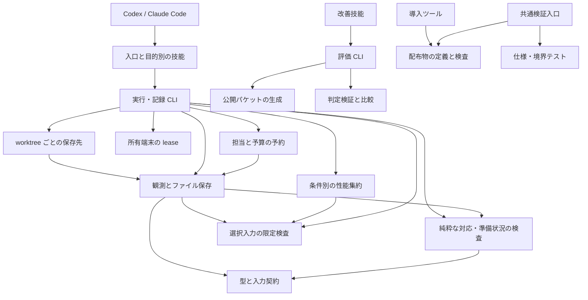

# アーキテクチャ

## 責務と依存方向

Moletta はホストのツールを使う技能一式と、ローカルで動く記録・検査・評価ツールで構成します。主担当エージェントが作業と担当を選び、ホストが実際の操作とモデル起動を行います。runtime は保存先、観測、端末の所有、性能集約、承認された担当の予約を扱います。

| 境界 | 所有する知識 | 所有しない知識 |
| --- | --- | --- |
| 技能 | 何を調べ、どう比較し、意味上の抜けを再検討するか | データの読み書き、ホスト固有の権限設定 |
| runtime の型 | JSON の形式、語彙、有効なデータ形状 | 実際の製品を操作する方法 |
| 保存・観測 | 封印、実験の事前記録、実行、取得元、観測・判定の保持 | 出力が利用者の目的を満たすか |
| 作業単位 | worktree 内の既定保存先、一意な ID、README、除外設定の案内 | Git 設定の自動変更、別 worktree との記録の統合 |
| 入力保護 | 選択ファイルの種類・サイズ、既知の認証情報パターン、保存出力の制限 | 任意の機密情報の判別、ホストの読み取り・送信権限の強制 |
| モバイル端末 | installed runtime の確認、未起動端末の割当、所有 lease、限定した解放 | OS の自動ダウンロード、案件固有の操作、実機 UX の判定 |
| 性能集約 | 対応する数値形式、単位と条件の分離、記述統計、比較 | 任意ログ・trace の解釈、測定の真正性、因果・合否判断 |
| 担当の予約 | ユーザー承認の申告、host catalog との照合、並列数と token 予約、使用量 | 人の認証、固定のモデル一覧、モデルの起動・停止、ホストの実行制限 |
| 検査 | 対応、証拠の適用範囲、各判断段階の構造上の条件 | 最適な案、資料や測定内容の真偽 |
| 評価 | ケースの分離、判定記録の整合性、比較計算 | エージェントの起動、自然言語の自動採点 |
| 配布 | 技能一式と参照の検査、両ホストへの配置 | ホストの自動選択、モデルの挙動 |

実行ツールと評価器は互いを import しません。評価ケースは runtime の内部モデルを再利用せず、独立した成果の観測を定義します。導入ツールは配布内容だけを扱い、作業中の実行記録やモデル認証を読みません。

runtime は `skills/moletta/scripts/` に置きます。`model.py` が観測の型と不変条件、`policy.py` が準備状況の検査、`store.py` が観測の状態遷移と保存、`workspace.py` が保存先の選択、`data_policy.py` が選択入力の限定検査を担当します。`devices.py` はホストで共有する端末 registry、`performance.py` は数値の取り込みと集約、`delegation.py` は承認方針と予約の記録を持ち、`moletta.py` が CLI を結び付けます。観測開始時の計画検査にも同じ policy を使います。

`workspace` と `delegation` は保存操作に `store` を使います。性能集約は観測の合格判定や評価器に依存せず、CLI が派生結果を run に保存します。端末 registry は複数 worktree の所有を調停し、run 内の receipt から未解放の義務を確認できます。各境界は自分の入力契約を所有し、別の層へ判断方針を複製しません。

## 意図、計画、観測

原文と固定した意図を基準に、計画の分解・案・実験を更新します。編集可能な計画に成功や失敗の測定結果を埋め込まず、観測と判定は保存ツールが保持します。

観測は実行前に開始し、意図、実験、対象の版、明示した入力を記録します。コマンド実行も、ホストが行った画面・機器操作の履歴を取り込む手順も同じライフサイクルを使います。取得元は区別し、判定には事前の合否基準と理由を必要とします。終了コード 0 だけでは合格になりません。出力がサイズ・形式・既知の認証情報の保存条件を満たさない場合は本体を残さず、`output_blocked` の診断観測を保存し、合格を拒否します。

失敗・不明の観測は履歴に残ります。別の適用可能な合格観測で解消を明示します。対象や実験が変われば、過去の観測は現条件の成功の根拠になりません。成果ごとの全体観測は、その成果へ対応する能力をまとめて含めます。準備状況は現在の計画と証拠から導出し、編集できる完了フラグにしません。[記録形式](../skills/moletta/references/record-format.md) がファイル契約を定義します。

## 資源と情報の境界

既定の `.moletta-runs/<作業単位ID>/` は worktree ごとのローカル資料です。共有 Git directory を保存先にせず、README と `/.moletta-runs/` の案内を作ります。`.gitignore` は変更しません。観測出力と添付物は明示した範囲を保存し、不透明な添付物には明示 opt-in を必要とします。限定的なファイル名・パターン検査は DLP や匿名化ではなく、ホストの権限を代替しません。[情報境界](../skills/moletta/references/security.md) を参照してください。

端末の OS runtime / system image は既存のインストールを共有し、可変データは割り当てた端末に分離します。割当は未起動の端末と具体的な起動 argv を返し、観測操作はホストが行います。lease は所有を確認して解放し、失敗は `cleanup_pending` に残します。`next` は完了判断へ進む前に未解放 lease の処理を提示し、`check --stage verify` は未解放 lease があると準備完了を拒否します。実機 UX は人の責任範囲です。

[性能集約](../skills/moletta/references/performance.md) は選択した構造化ファイルだけを読み、元ログをコピーせず、ハッシュと条件ごとの統計を残します。baseline / candidate は build revision 以外の比較条件が一致しなければ拒否します。性能差を実装の因果や UX の正しさへ読み替えません。

[担当の予約](../skills/moletta/references/adaptive-delegation.md) は、実行と判断の役割ごとに、実際のユーザー承認と 24 時間以内に確認した host catalog を照合します。固定のモデル名は持ちません。起動前に予算を予約し、終了後に使用量を記録します。使用量不明の担当は予約枠を使い続け、費用不明なら総費用は `null` です。承認と使用量は申告であり、起動、停止、時間・token の実行上限、文脈の分離はホストが担います。

## 全体の判断と作業量

人のゴールは安定した判断基準です。分解と方式は仮説であり、目的に寄与しない局所改善や環境差が見つかれば、全体構成から比較し直します。複数案・試作・レビューは選択を変えるときに使い、すべての作業へ同じ工程を課しません。

[発言の解釈と範囲の判断](../skills/moletta/references/intent-and-scope.md) は、要求抽出と方式の採用に先立つ主担当の責務です。発言の意味、案の採否、実行権限を分け、必要なときに全体への効果・依存・故障範囲・保守や利用負担を評価します。既存の notes / options / decision / review を使い、別の分類器や状態機械を追加しません。型や引用の検査では、発言の意味や必須性を認定できません。

人の最新の決定を参照し、重要な解釈の曖昧さ・価値判断・必須条件の衝突だけを、推奨と具体的な選択肢付きで人へ返します。明確な小変更に審査を追加せず、回答待ちはその判断に依存する作業へ限定します。採用済みの機能を、未採用の案や主担当の好みだけで自動削除することもしません。

重要な判断では、別文脈のレビューへ原文と生の資料を先に渡し、必要能力を独立に再構成させます。主担当が証拠・異論・費用を統合します。投票数は正しさの根拠になりません。

## 拡張する場所

- 判断方針の改善は該当技能・参照資料へ、保存・対応の不変条件は runtime へ置きます。
- 製品ごとの操作はホストまたは案件のツールで行い、観測手順で実際の出力を記録します。Moletta の型へ製品 SDK の型を持ち込みません。
- 回帰ケースは独立した依頼と生の資料から追加します。評価者用の期待結果は solver のパケットへ入れません。
- 公開 CLI と JSON 契約を変更する際は、呼び出す技能・例・テストを同時に更新します。要求のない互換層は追加しません。
