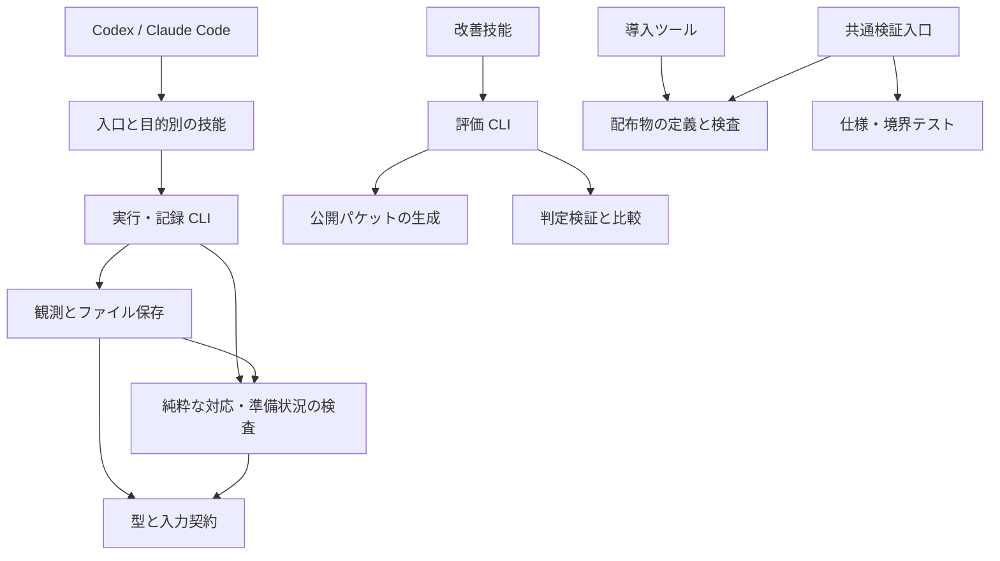

# アーキテクチャ

## 責務と依存方向

Moletta はホストのツールを使う技能一式と、ローカルで動く記録・検査・評価ツールで構成します。常駐ランナーやモデル選択機構を持たず、主担当エージェントが作業を進めます。

| 境界 | 所有する知識 | 所有しない知識 |
| --- | --- | --- |
| 技能 | 何を調べ、どう比較し、意味上の抜けを再検討するか | データの読み書き、ホスト固有の権限設定 |
| runtime の型 | JSON の形式、語彙、有効なデータ形状 | 実際の製品を操作する方法 |
| 保存・観測 | 封印、実験の事前記録、実行、取得元、観測・判定の保持 | 出力が利用者の目的を満たすか |
| 検査 | 対応、証拠の適用範囲、各判断段階の構造上の条件 | 最適な案、資料や測定内容の真偽 |
| 評価 | ケースの分離、判定記録の整合性、比較計算 | エージェントの起動、自然言語の自動採点 |
| 配布 | 技能一式と参照の検査、両ホストへの配置 | ホストの自動選択、モデルの挙動 |

実行ツールと評価器は互いを import しません。評価ケースは runtime の内部モデルを再利用せず、独立した成果の観測を定義します。導入ツールは配布内容だけを扱い、作業中の実行記録やモデル認証を読みません。

runtime は `skills/moletta/scripts/` に置きます。`model.py` が型と共通の不変条件、`policy.py` が準備状況の検査、`store.py` が観測の状態遷移と保存、`moletta.py` が CLI を担当します。観測開始時の計画検査にも同じ policy を使います。各層の入力・出力契約を、別の層で重複して実装しません。

## 意図、計画、観測

原文と固定した意図を基準に、計画の分解・案・実験を更新します。編集可能な計画に成功や失敗の測定結果を埋め込まず、観測と判定は保存ツールが保持します。

観測は実行前に開始し、意図、実験、対象の版、明示した入力を記録します。コマンド実行も、ホストが行った画面・機器操作の履歴を取り込む手順も同じライフサイクルを使います。取得元は区別し、判定には事前の合否基準と理由を必要とします。終了コード 0 だけでは合格になりません。

失敗・不明の観測は履歴に残ります。別の適用可能な合格観測で解消を明示します。対象や実験が変われば、過去の観測は現条件の成功の根拠になりません。成果ごとの全体観測は、その成果へ対応する能力をまとめて含めます。準備状況は現在の計画と証拠から導出し、編集できる完了フラグにしません。[記録形式](../skills/moletta/references/record-format.md) がファイル契約を定義します。

## 全体の判断と作業量

人のゴールは安定した判断基準です。分解と方式は仮説であり、目的に寄与しない局所改善や環境差が見つかれば、全体構成から比較し直します。複数案・試作・レビューは選択を変えるときに使い、すべての作業へ同じ工程を課しません。

重要な判断では、別文脈のレビューへ原文と生の資料を先に渡し、必要能力を独立に再構成させます。主担当が証拠・異論・費用を統合します。投票数は正しさの根拠になりません。

## 拡張する場所

- 判断方針の改善は該当技能・参照資料へ、保存・対応の不変条件は runtime へ置きます。
- 製品ごとの操作はホストまたは案件のツールで行い、観測手順で実際の出力を記録します。Moletta の型へ製品 SDK の型を持ち込みません。
- 回帰ケースは独立した依頼と生の資料から追加します。評価者用の期待結果は solver のパケットへ入れません。
- 公開 CLI と JSON 契約を変更する際は、呼び出す技能・例・テストを同時に更新します。要求のない互換層は追加しません。
